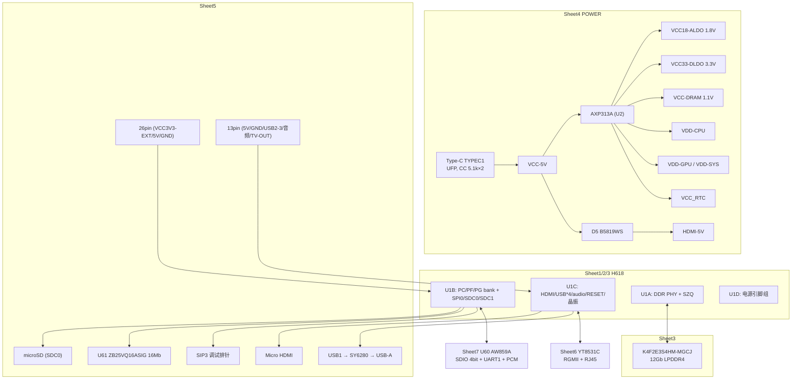

# 02 · 原理图分析（Orange Pi Zero 3 / Allwinner H618）

> 分析对象：`docs/source/schematic.pdf`（7 页，A3 横向；标题栏 `Xunlong Software Co., Limited` / `Design Name: ORANGEPI Zero3-4G`，日期 2023-06-15 与 2023-07-13，`Sheet: 1/7 … 7/7`）
> 页名（按标题栏 `Page Name`）：**Sheet 1 = SOC1、Sheet 2 = SOC2、Sheet 3 = LPDDR4、Sheet 4 = POWER、Sheet 5 = CARD-USB-DEBUG-EXT26-HDMI、Sheet 6 = 1000M ETH、Sheet 7 = WIFI AW859A**
> 读图方法：120dpi 全页看拓扑 → `pdftoppm -r 300` 全页 + 局部裁切放大读丝印/网络名（复现命令见 `docs/evidence/schematic_notes.md`），并用 `pdftotext -bbox` 的文字坐标交叉校验"网络名 ↔ 引脚号"的对应关系（此图 PDF 里引脚号绘制在引脚线上方约 2 pt，纯看图容易错位一行）。

**记号约定**

| 记号 | 含义 |
|---|---|
| ✅ | 图上直接可读（网络名/器件丝印/引脚号清楚） |
| ⚠️ | 图上可读，但有需要留意的条件（复用、无保护、命名不规范等） |
| 🧠 | **推断**（由图上连接关系推出，图上未直接写结论） |
| ❓ | **未确认**（丝印不清/图上缺失/需实物或数据手册确认） |

**器件型号一律按丝印原文抄写；凡读不清的一律标 ❓，不做型号猜测。**

---

## 1. 结论速览

| # | 结论 | 依据 |
|---|---|---|
| 1 | SoC 为 **H618**（BGA-284，原理图拆成 U1A/U1B/U1C/U1D 四个单元） | Sheet 1/2/3（`H616-BGA-284` 丝印，页内器件名 H616；手册 1.4 写 H618） |
| 2 | 电源为**单芯片方案 AXP313A**（U2，QFN21P40B300_300H78），3 路 DCDC + ALDO1 + DLDO1 + RTCLDO | Sheet 4 |
| 3 | 输入只有 **Type-C 5V**（UFP：CC1/CC2 各 5.1k 下拉，无 PD 协商），VCC-5V 与 VBUS 同网络 | Sheet 4 |
| 4 | 三路 DCDC：`DCDC1→VDD-GPU`、`DCDC2→VDD-CPU`、`DCDC3→VCC-DRAM`；且 **VDD-SYS 与 VDD-GPU 在去耦排上并为同一网络** | Sheet 2/4 ✅ + 🧠 |
| 5 | 图面导线显示：1.8V 组接 **ALDO1（pin15）/`VCC18-ALDO`**、3.3V 组接 **DLDO1（pin12）/`VCC33-DLDO`**；但 Sheet 4 汇总块表头写成 `BLDO1`/`ALDO1`，命名自相矛盾，**待确认**（§6 R3） | Sheet 4 ✅/❓ |
| 6 | 存储：**16Mbit SPI NOR（U61 ZB25VQ16ASIG）+ microSD（SDC0，PF0–PF5）**；DRAM 为 **K4F2E3S4HM-MGCJ 12Gb LPDDR4 = 1.5GB，32bit（2ch×16）** | Sheet 1 / Sheet 3 ✅ |
| 7 | **TF 卡有卡检测（CD）**：卡座 pin9 经 Q1(2SK3018) 反相成 `SDC0-DET` → SoC **PF6** | Sheet 1/5 ✅ |
| 8 | **USB0（Type-C）不限流**；限流芯片 SY6280 只用在 **USB1（USB-A 口）** 的 VBUS（ISET 6K8-1%） | Sheet 4/5 ✅ |
| 9 | 调试串口 = **UART0（PH0/PH1）→ 100Ω 串阻（R24/R26）→ 3 脚排针 SIP3**，3.3V TTL，非 RS232 | Sheet 1/5 ✅ |
| 10 | 26pin 的 5V 脚与 13pin 的 5V 脚**都直连 VCC-5V（= Type-C VBUS）**，无保险丝/限流/ESD | Sheet 5 ✅ |
| 11 | 26pin 的 3.3V 脚来自 **VCC3V3-EXT**（DLDO1 派生），26pin GPIO 全部 3.3V | Sheet 4/5 ✅，与手册 3.16(3) 一致 |
| 12 | 以太网是**外置千兆 PHY YT8531C**（RGMII，PHY addr=1，25MHz 晶振，RJ45 集成变压器）；SoC **内部 100M EPHY 全部 NC** | Sheet 2/6 ✅ |
| 13 | WiFi/BT：Sheet 7 U60 丝印 **AW859A**；`20U5622` 是 CdTech 模块型号，**AW859A 与 UWE5622 是同一颗芯片**，SDK 驱动名即 uwe5622（已结案，见 §6 R1 / `docs/08`） | Sheet 7 / 手册 / SDK / `docs/08` |
| 14 | WiFi SDIO 为 **1.8V 域**（`VCC-PG`=1.8V，`SDIO` 上拉 30K 到 `VCC-WIFI-IO`），模块 VBAT 由 `VCC33-WIFI`（3.3V）供电 | Sheet 4/7 ✅ + 🧠 |
| 15 | HDMI 5V 仅经 **D5 B5819WS 肖特基**从 VCC-5V 取电，**无过流/限流**；HPD 为 5V 信号经 **1K（RH5）** 直入 SoC | Sheet 5 ✅ |
| 16 | **图上未见 HDMI/USB 的 ESD 阵列器件**（只有两处孤立文字 "0721"），这条 ❓ 需实物核对 | Sheet 5 ❓ |
| 17 | 板上**没有 RTC 备份电池**（VCC_RTC 只有 CP11 4.7uF ‖ RP6 510R 到地）→ 断电不保时 🧠 | Sheet 4 ✅ |
| 18 | **无 FEL 按键/跳线/测试点**：FEL(B17)、JTAG_SEL(C16)、PLLTEST(D14)、LRADC(L18) 全部 NC | Sheet 2 ✅ |
| 19 | 各页标题栏彼此不一致：Sheet3 写 `Zero3-2G`，其余 6 页写 `Zero3-4G`，而实际 DRAM 是 1.5GB | 各页标题栏 / Sheet 3 ✅ |
| 20 | **调试口没有板载 USB-UART**，需要外接 3.3V USB-TTL；电源指示灯是 GPIO（PC12/PC13）驱动，不是硬件电源指示 | Sheet 1/5 ✅ |

---

## 2. 全板框图与电源树

### 2.1 全板框图（按页归类）



### 2.2 电源树（输入 → 各级 rail → 负载）

> ⚠️ AXP313A 的**输出电压由 I²C 寄存器设定**（图上没有外部反馈分压电阻，`DCDC1/2/3` 引脚是反馈端），所以"电压值"只能给 LPDDR4/1.8V/3.3V 这类**由负载标准确定的量级**，具体设定点需查固件/实测（❓）。电流能力图上未标注（❓）。

```text
Type-C VBUS (VCC-5V)  ──┬─ VIN1(17) ─ DCDC1 ─ LX1(18)──LP1 1.0uH──▶ VDD-GPU (=VDD-SYS)   ~0.9–1.1V 🧠
   CP1/CP6/CP9 22uF×3    ├─ VIN2(20) ─ DCDC2 ─ LX2(19)──LP2 1.0uH──▶ VDD-CPU             ~0.9–1.1V 🧠
   （各 VIN 就近去耦）    ├─ VIN3(2)  ─ DCDC3 ─ LX3(3) ──LP3 1.0uH──▶ VCC-DRAM (LPDDR4)  1.10V 🧠
                        ├─ ALDO1(15) ─────────────────────────────▶ VCC18-ALDO 1.8V
                        ├─ DLDO1(12) ─────────────────────────────▶ VCC33-DLDO 3.3V
                        ├─ RTCLDO(7) ─────────────────────────────▶ VCC_RTC
                        └─ D5 B5819WS ────────────────────────────▶ HDMI-5V (§3.5)

1.8V 组（ALDO1 / net VCC18-ALDO）  ：VCC18-ALDO · VCC18-HDMI · VCC18-TV · AVCC · VCC-PLL ·
                                    VCC-PG · VCC-WIFI-IO · VDD18-LPDDR · VDD18-DRAM
3.3V 组（DLDO1 / net VCC33-DLDO）  ：VCC33-DLDO · VCC-IO · VCC-PC · VCC33-USB · VCC33-EPHY ·
                                    DCDCE · VCC33-CARD · VCC3V3-EXT · RGMII_3V3 · VCC33-WIFI
```

| Rail（网络名） | 来源器件/引脚 | 电压 | 主要负载 | 依据 |
|---|---|---|---|---|
| `VCC-5V` | Type-C VBUS（A4/A9/B4/B9） | 5V（外部输入） | PMU VIN1/2/3、HDMI D5、USB-A SY6280、26pin/13pin 5V | Sheet 4 / Sheet 5 ✅ |
| `VDD-GPU`（=`VDD-SYS`） | AXP313A DCDC1（LX1→LP1 1.0uH；FB=`DCDC1` pin16，net `VDD-GPUFB`） | ~0.9–1.1V 🧠 | SoC VDD_GPU1–4、VDD_SYS1–6 | Sheet 2/3/4 ✅+🧠 |
| `VDD-CPU` | DCDC2（LX2→LP2 1.0uH；FB=`DCDC2` pin1，net `VDD-CPUFB`） | ~0.9–1.1V 🧠 | SoC VDD_CPU1–6 | Sheet 2/3/4 ✅+🧠 |
| `VCC-DRAM` | DCDC3（LX3→LP3 1.0uH；`DCDC3` pin4） | 1.10V（LPDDR4 VDDQ/VDD1） 🧠 | SoC VCC_DRAM1-3、DRAM VDD1/VDD2、ZQ/ODT 上拉 | Sheet 3/4 ✅+🧠 |
| `VCC18-ALDO` → 1.8V 组 | ALDO1（pin15），CP2 47uF + CP12 100nF | 1.8V 🧠 | 见上"1.8V 组" | Sheet 4 ✅ |
| `VCC33-DLDO` → 3.3V 组 | DLDO1（pin12），CP3 47uF + CP13 100nF | 3.3V | 见上"3.3V 组" | Sheet 4 ✅ |
| `VCC_RTC` | RTCLDO（pin7）+ CP11 4.7uF ‖ RP6 510R | 1.8~3.3V 🧠（❓） | SoC RTC 域 | Sheet 4 ✅ |
| `VCC33-CARD` | 3.3V 组 | 3.3V | TF 卡 VDD、卡检测上拉 RC1/RC3 | Sheet 5 ✅ |
| `VCC33-USB` | 3.3V 组 | 3.3V | SoC `VCC_USB`(M18) | Sheet 2/4 ✅ |
| `VCC33-EPHY` | 3.3V 组 | 3.3V | SoC `VCC_EPHY`(E18)（EPHY 引脚本身 NC，见 §6 R14） | Sheet 2/4 ✅ |
| `VCC33-WIFI` | 3.3V 组 | 3.3V | AW859A `VBAT`(pin9) | Sheet 7 ✅ |
| `VCC-WIFI-IO` | 1.8V 组 | 1.8V | AW859A `VDDIO`(pin22)、SDIO 上拉 RW1-RW5 | Sheet 4/7 ✅ |
| `DCDCE` | 3.3V 组（❓名字含义不明） | 3.3V | SPI0 上拉 R38/R23/R20、NOR Flash VDD/HOLD#/WP# | Sheet 1 ✅ |
| `VCC3V3-EXT` | 3.3V 组 | 3.3V | 26pin 1/17 脚、I²C 上拉 R28-R31 2K | Sheet 5 ✅ |
| `RGMII_3V3` | 3.3V 组 | 3.3V | YT8531C `0_DVDD33`、MDIO 上拉 R8 1.5K | Sheet 6 ✅ |
| `HDMI-5V` | VCC-5V 经 D5 B5819WS（SOD-323） | ~5V-0.3V 🧠 | HDMI 连接器 pin19、DDC 上拉 RH2/RH4 1.8K | Sheet 5 ✅ |
| `VCC18-HDMI / VCC18-TV / AVCC / VCC-PLL / VCC-PC / VCC-PG / VCC-IO` | 见上两组 | 1.8V / 3.3V | SoC 各电源域 | Sheet 1/2/4 ✅ |

### 2.3 上电/复位时序链

```text
插入 Type-C 5V
  → VCC-5V
  → AXP313A 上电（PWRON 脚接 CK1 100nF 到地 + 测试点 T1，板上无按键 🧠 → 上电即自启动）
  → 各 DCDC/LDO 建立（时序由 PMIC 内部 OTP 决定，图上无 PG/EN 链可读 ❓）
  → PMIC PWROK(13) ──net AP-RESET──▶ RS1 100R ── net RESET ──▶ SoC RESET(A16)
                                     （RESET 由 VCC-PLL 经 RS7 10K 上拉，CS3 1nF 到地）
  → SoC 复位释放 → BROM 依 BOOT strap 选启动介质（§4.1）
```

---

## 3. 逐页分析

### 3.1 Sheet 1 — SOC1（U1B：PC/PF/PG bank、SPI NOR、SDC0/SDC1、启动 strap）

**本页作用**：SoC 的主 GPIO/存储/启动引脚单元（`H616-BGA-284` 的 U1B），外加板载 SPI NOR 和启动选择电阻。

**关键器件**

| 器件 | 丝印 | 作用 |
|---|---|---|
| U1B | `H616-BGA-284` | SoC 单元 B（PC0–PC16 / PF0–PF6 / PG0–PG19） |
| U61 | `ZB25VQ16ASIG` | 16Mbit（2MB）SPI NOR，启动介质 + 固件存储 |
| R38/R23/R20/R19 | `10K` `R0201` | BOOT strap / SPI 上拉下拉 |
| RS4 / R33 | `10R` `R0201` | SDC0-CLK / SDC1-CLK 串阻 |
| R42 | `0R` | `PMU_IRQ` ↔ `PC9` 的连接桥 |
| CS11 / CS7 / CS30+CS28 | 2.2uF / 10uF / 100nF+2.2uF | VCC-PC / VCC-PG / VCC-IO 就近去耦 |

**关键 net（引脚↔网络，全部 ✅）**

| 功能 | 引脚 | 网络名 | 备注 |
|---|---|---|---|
| SPI0_CLK | B1(PC0) | `SPI0_CLK` | 与 SPI Flash `SPI_SCK` 同网 |
| SPI0_MOSI | C1(PC2) | `SPI0_MOSI` | → Flash `SPI_SI` |
| SPI0_CS0 | D1(PC3) | `SPI0_CS0` | = BOOT_SEL1，R38 10K 上拉到 `DCDCE` |
| SPI0_MISO | D2(PC4) | `SPI0_MISO` | = BOOT_SEL2，R23 10K 上拉到 `DCDCE` |
| BOOT strap | E2(PC5) | `PC5` | = BOOT_SEL3，**R19 10K 下拉到 GND** |
| BOOT strap | F6(PC6) | `PC6` | = BOOT_SEL4，R20 10K 上拉到 `DCDCE` |
| SDC0（TF） | J2/J3/K1/K3/L2/L3 | `SDC0-D1/-D0/-CLK/-CMD/-D3/-D2` | PF0/PF1/PF2/PF3/PF4/PF5；CLK 串 RS4 10R |
| SDC0 卡检测 | K2(PF6) | `SDC0-DET` | 由 TF 卡座 CD 经 Q1 反相而来（§3.5） |
| SDC1（WiFi） | A6/C7/C6/B5/C5/B7 | `WL-SDIO-CLK/-CMD/-D0..-D3` | PG0–PG5；CLK 串 R33 10R，其余无串阻 |
| UART0 调试 | PH0/PH1（D16/D15） | `CPUX-UTX` / `CPUX-URX` | 经 R24/R26 100R 到 SIP3 |
| UART1（BT） | A4/B4 | `BT-UART-RX` / `BT-UART-TX` | PG6/PG7；**命名以模块侧为准（交叉！）** |
| UART1 流控 | PG8/PG9 | `BT-UART-CTS` / `BT-UART-RTS` | 与 AW859A `UART_RTS_N/CTS_N` 对接 |
| UART5 | PH2/PH3 | `UART5_TX` / `UART5_RX` | → 26pin 8/10 |
| I²C3 | PH4/PH5 | `TWI3-SCK` / `TWI3-SDA` | → 26pin 5/3，2K 上拉 |
| SPI1 | PH6/PH7/PH8/PH9 | `SPI1_CLK`/`SPI1_MOSI`/`SPI1_MISO`/`SPI1_CS` | → 26pin 23/19/21/24 |
| I²S2/PCM | PG11–PG14 | `BT-PCM-CLK/-SYNC/-DIN/-DOUT` | → AW859A PCM |
| 32K 输出 | PG10 | `AP-CK32KO` | → AW859A `LPO`（🧠） |
| WiFi/BT 控制 | PG18/PG19/PG16/PG17 | `WL-REG-ON` / `BT-REG-ON` / `BT-WAKE-AP` / `AP-WAKE-BT` | 见 §3.7 |
| WiFi 唤醒 | PG15（A8） | `WL-WAKE-AP` | 在 Sheet 7 别名区与 `WL-WAKE-HOST` 并联（§3.7） |
| LED | PC12 / PC13 | `PWR-LED` / `STATUS-LED` | R21 1K / R22 470R |
| 软 I²C 候选 | PC14 / PC15 | `GPIO-SCK` / `GPIO-SDA` | → 26pin 18/16（PC14/PC15 本身无硬件 I²C 功能 🧠） |
| USB 供电使能 | PC16 | `USB1-DRVVBUS` | → SY6280 `EN`（Sheet 5） |
| PMIC I²C | PL0 / PL1 | `PMU-SCK` / `PMU-SDA` | 走 `S_TWI0/RSB` 复用（**不是**普通 TWI） |
| PMIC 中断 | PC9 | `PC9` —— R42 0Ω —— `PMU_IRQ` | PC9 同时引到 26pin 7 脚（§6 R8） |
| 13pin GPIO | PC1 / PI16 / PI6 | `PC1` / `PI16` / `PI6` | 13pin 10/11/12 |
| 红外 | PH10 | `IR-RX` | 13pin 13 |
| 电源脚 | F5 / D7 | `VCC-PC`（注记 **3.3V**）/ `VCC-PG`（注记 **1.8/3.3V**） | Sheet 4 把 VCC-PG 归入 1.8V 组 ✅ |

**注意事项**

- 页面顶部有一段英文注记（✅ 原文大意）：*"1. Note that the voltage of SOC GPIO must match the external IO voltage. 2. The pull up voltage of the GPIO is selected to correspond to the power field voltage of GPIO."* —— 即 GPIO 电平/上拉必须跟随所在电源域。
- `SPI0_*` 与 `BOOT_SEL1/2` 是**同一批引脚**（PC3/PC4 复用为 BOOT_SEL1/2），SPI Flash 与启动 strap 硬件上共用，改动这些上拉会同时影响启动与 Flash 通信 ⚠️。
- NOR Flash 的 `WP#`(3) 和 `HOLD#`(7) 都直接接 `DCDCE`(3.3V)（✅ 从图上看是拉高），即**硬件不写保护**；`VDD`(8) 也接 `DCDCE`，去耦 C27 1uF。
- `PMU_IRQ` 通过 R42(0Ω) 与 `PC9` 相连，而 `PC9` 又被引到 26pin 7 脚 —— 这条"隐藏复用"用户手册没有写（§6 R8）。
- 图上 `DCDCE` 这个网络名出现在 SPI 上拉与 Flash 供电处，从 Sheet 4 的 3V3 组看它是 3.3V rail，但**名字含义不明**（❓）。

### 3.2 Sheet 2 — SOC2（U1C/U1D：HDMI、USB×4、音频/TV-OUT、复位、晶振、电源引脚）

**本页作用**：SoC 的高速/模拟接口单元 + 电源引脚汇总 + 去耦。

**关键器件与引脚（✅）**

| 功能 | 引脚 | 网络 | 备注 |
|---|---|---|---|
| HDMI TMDS 0 | E19/E20 | `HTX0P`/`HTX0N` | 差分对 |
| HDMI TMDS 1 | D20/D21 | `HTX1P`/`HTX1N` | |
| HDMI TMDS 2 | C19/C20 | `HTX2P`/`HTX2N` | |
| HDMI CLK | F20/F21 | `HTXCP`/`HTXCN` | |
| HDMI DDC | F19 / G21 | `HSCL` / `HSDA` | 5V 域信号（DDC 上拉到 HDMI-5V，§3.5） |
| HDMI CEC | G17 | `HCEC` | |
| HDMI HPD | G18 | `HHPD` | 5V 输入经 1K（RH5） |
| HDMI 1.8V | F18 | `VCC18-HDMI` | 1.8V 组 |
| USB0（OTG/Type-C） | J19 / J20 | `USB0-DM` / `USB0-DP` | Type-C 直连，无限流 |
| USB1（USB-A） | M19 / M20 | `USB1-DM` / `USB1-DP` | VBUS 经 SY6280 |
| USB2 / USB3 | K19/K20、L19/L20 | `USB2-DM/DP`、`USB3-DM/DP` | **只到 13pin 排针**（扩展板引出） |
| USB PHY 电源 | M18 | `VCC33-USB` | 3.3V |
| 内部 EPHY | B19/A19/A20/B20/B21 | **NC（图上打 ×）** | 100M EPHY 未使用 |
| EPHY 电源 | E18 | `VCC33-EPHY` | 仍接 3.3V（见 §6 R14） |
| 音频输出 | G19/G20 | `LINEOUTL`/`LINEOUTR` | → 13pin 8/7（经扩展板 3.5mm） |
| TV-OUT | J21 | `TV-OUT` | `VCC_TV` H20 ← `VCC18-TV`；→ 13pin 9 |
| 模拟参考 | J18/J17 | `VRA1`/`VRA2` | DDR 参考电压 |
| 音频模拟 | H17/H18 | `AVCC` / `AGND` | |
| 基准电阻 | K18 | `REXT` → **RS8 150K-1%** → GND | |
| 复位输入 | A16 | `RESET` ← RS1 100R ← `AP-RESET`（PMIC PWROK） | 上拉 VCC-PLL RS7 10K，CS3 1nF |
| FEL / JTAG_SEL / LRADC / PLLTEST | B17 / C16 / L18 / D14 | **NC** | 见 §4.5 |
| 24MHz 晶振 | B11/C12 | `DCXO-XIN`/`DCXO-XOUT` → XS1 `TSX-2016 24M-12pF-10PPM` | CS1/CS2 12pF |
| PLL/晶振电源 | D12 / D13 | `VCC-PLL` / `DXLD0-OUT` | `DXLD0-OUT` 去耦 CS10 220nF |

**去耦（✅）**

| 电源域 | 电容 |
|---|---|
| `VDD-CPU` | CS22 47uF + CS12 2.2uF + CS24 47uF + CS26 2.2uF + CS14 47uF + CS19 2.2uF |
| `VDD-SYS` **与** `VDD-GPU`（同一网络） | CS32 22uF + CS18 47uF + CS13 2.2uF + CS16 2.2uF + CS31 47uF + CS23 2.2uF |
| `VCC-IO` | CS4 22uF + CS5 100nF |
| `DXLD0-OUT` | CS10 220nF |
| `AC-VRA1` / `AC-AVCC` | CS6 1uF / CS8 10uF |
| `VRA2` / `VRA1` / `AVCC` | CS25 470nF / CS27 470nF / CS21 2.2uF |

页面注记：`Placed close to the SOC`（✅）。

**注意事项**

- **VDD-SYS 与 VDD-GPU 在去耦排上被同一根铜线连在一起**（✅ 图上两个网络标签接在同一去耦母线；因此它们是同一电气节点 🧠）。含义：GPU 与 SYS 共用 DCDC1，只有 CPU 独立一路 —— 做功耗/频率实验时不能假设 GPU 与 CPU 分压。
- 内部 100M EPHY 未使用而 `VCC33-EPHY` 仍供电，属于"留空但上电"的处理（见 §6 R14）。
- 页内还有一条绿色注记（✅ 原文）：`JTAT-B 0: FORCE JTAG TO PG / 1: SWITCH JTAG TO PG OR PF. DEFAULT PF.`（`JTAT-B` 疑为 `JTAG-B` 笔误；`JTAG_SEL`(C16) 本身 NC ❓ 与注记如何对应需实物确认）。

### 3.3 Sheet 3 — LPDDR4（U1A + UD1A/UD1B）

**本页作用**：DDR PHY（U1A）与 LPDDR4 颗粒（UD1A/UD1B 同一颗料的两半符号）之间的全部信号、阻抗/终端电阻与电源去耦。

**关键器件（✅）**

| 器件 | 丝印 | 说明 |
|---|---|---|
| UD1A / UD1B | `K4F2E3S4HM-MGCJ 12Gb LPDDR4_FBGA200 10X15`；封装行 `BGA200P65_80B1000_1500H90`；组织 `48Mbx16DQx8banksx2xchannels` | **12Gb = 1.5GB，2 channel × 16bit = 32bit**（🧠 由此推总线宽度） |
| U1A | `H616-BGA-284` | SoC DDR PHY 单元 |
| RD5 | `240R-1%` `R0201` | SoC `SZQ`(L15) → GND（DDR PHY ZQ 校准） |
| RD3 / RD4 | `240R-1%` | DRAM `ZQ0`(A5)/`ZQ1`(A8) → **VCC-DRAM** |
| RD1 / RD2 | `100K` | DRAM `ODT_CA_A`(G2)/`ODT_CA_B`(T2) → **VCC-DRAM**（CA ODT 使能 🧠） |

**关键 net**：`SDQ0..SDQ31`、`SDQS0P/N..SDQS3P/N`、`SDQM0..3`、`SA0..SA15`（含 CA 复用）、`SBA0/1`、`SCS0/1`、`SCKP/SCKN`、`SCKE`、`SRST`、`SODT`、`SZQ`；地址/命令在网络名里带 `_A`/`_B` 后缀以区分两个 channel（✅）。

**电源/去耦（✅）**

- `VCC-DRAM`（1.1V）：CD11 47uF + CD12/CD13/CD14 1uF/1uF/2.2uF + CD15 2.2uF + CD16 2.2uF（另有底部一排 CD1–CD8）。
- `VDD18-LPDDR`：VDD18-LPDDR/VDD18-DRAM 分两处去耦（CD17 47uF、CD28 100nF、CD29 100nF、CD31 10uF、CD32 100nF、CD33/CD34、CD35/CD36 等）。
- 页面注记：`Placed on bottom`（多处，✅ 指这些电容放在 PCB 背面）。

**注意事项**

- 本页 `VCC-DRAM` 有两条路径同时出现：SoC 侧 `VCC_DRAM1/2/3`(L9/L10/L11/L12) 与 DRAM 侧 `VDD1-x`/`VDD2-x`，全部同网络（✅）。
- **ZQ 电阻的位置不同**：SoC 的 `SZQ` 到 **GND**，DRAM 的 `ZQ0/ZQ1` 到 **VCC-DRAM**（✅ 这是 LPDDR4 的标准做法，不是错误；但排查"内存不稳"时别把两者混为一谈）。
- 标题栏是 `ORANGEPI Zero3-2G`，与其余 6 页 `Zero3-4G` 及实际 12Gb 颗粒不符（§6 R2）。

### 3.4 Sheet 4 — POWER（Type-C + AXP313A + 电源汇总块）

**本页作用**：唯一输入口（Type-C）、PMIC、以及"1V8/3V3 网络归属"汇总。

**Type-C 接口（TYPEC1，丝印亦见 `TPYE-C`（拼写笔误）/`TYPEC_SV`）✅**

| 连接器引脚 | 网络 | 说明 |
|---|---|---|
| A6(DP1)/A7(DN1)、B6(DP2)/B7(DN2) | `USB0-DP` / `USB0-DM` | 只做 USB2.0，**SuperSpeed 四对全部 NC** |
| A5(CC1) / B5(CC2) | 经 **RP25 / RP26 5.1k** 到 GND | UFP（sink）接法，**无 PD 控制器**，故不能协商高压/大电流 |
| A8(SBU1)/B8(SBU2) | NC | |
| A4/A9/B4/B9 | `VCC-5V` | 四个 VBUS 全并，CP14 10uF + CP24 100nF（B 侧 CP18 10uF + CP22 100nF） |
| A1/A12/B1/B12、H1–H4（壳） | GND | |

**PMIC：U2 `AXP313A`（丝印封装 `QFN21P40B300_300H78`）✅**

| 引脚 | 名称 | 连接 | 外围 |
|---|---|---|---|
| 17 / 20 / 2 | VIN1 / VIN2 / VIN3 | `VCC-5V` | CP1/CP6/CP9 各 22uF（注记：CPU/GPU 均预留 22uF） |
| 18 / 16 | LX1 / DCDC1（FB） | LP1 1.0uH（`IND_252012`，`1.0uH@2A DCR<0.1R`）→ `VDD-GPU` / 反馈 `VDD-GPUFB` | CP3/CP4/CP5/CP13/CP15/CP16 47uF×3 + 100nF×3 |
| 19 / 1 | LX2 / DCDC2（FB） | LP2 1.0uH → `VDD-CPU` / `VDD-CPUFB` | CP7/CP8/CP17/CP19 47uF×2 + 100nF×2 |
| 3 / 4 | LX3 / DCDC3 | LP3 1.0uH → `VCC-DRAM` | CP10 47uF + CP20/CP21 100nF |
| 15 | ALDO1 | `VCC18-ALDO` | CP2 47uF + CP12 100nF |
| 12 | DLDO1 | `VCC33-DLDO` | CP3（DLDO 侧）47uF + CP13 100nF |
| 7 | RTCLDO | `VCC_RTC` | CP11 4.7uF ‖ **RP6 510R** 到 GND |
| 5 / 6 | SDA / SCL | `PMU-SDA` / `PMU-SCK`（← SoC PL1/PL0，Sheet 1） | — |
| 11 | IRQ | `PMU_IRQ`（→ Sheet 1 经 R42 0R 到 PC9） | — |
| 13 | PWROK | `AP-RESET`（C28 1nF 到地） | → Sheet 2 经 RS1 100R 到 SoC `RESET` |
| 14 | PWRON | `PWRON`（CK1 100nF 到地 + `T1`） | **无按键**；`T1` 为单端斜四边形符号（❓ 疑测试点/按键位） |
| 8 | GPO | 经 C29 1uF 到地 + `T1` 另一侧（❓ 符号不闭合，连接关系未确认） | — |
| 10 / 9 / 21 | NC / GND / EPAD | NC / GND / GND | — |

**电源汇总块（本页左侧，✅ 但存在命名矛盾）**

- `1V8` 区块表头文字是 **`BLDO1`**，列出：`VCC18-ALDO`、`VCC18-HDMI`、`VCC18-TV`、`AVCC`、`VCC-PLL`、`VCC-PG`、`VCC-WIFI-IO`、`VDD18-LPDDR`、`VDD18-DRAM`。
- `3V3` 区块表头文字是 **`ALDO1`**，列出：`VCC33-DLDO`、`VCC-IO`、`VCC-PC`、`VCC33-USB`、`VCC33-EPHY`、`DCDCE`、`VCC33-CARD`、`VCC3V3-EXT`、`RGMII_3V3`、`VCC33-WIFI`。
- ⚠️ **交叉矛盾**：PMIC 侧实测连接是 **ALDO1(pin15)→`VCC18-ALDO`（1.8V 组）**、**DLDO1(pin12)→`VCC33-DLDO`（3.3V 组）**；而汇总块却把"1V8"标成 `BLDO1`、"3V3"标成 `ALDO1`，且 AXP313A 符号里**没有 BLDO1 这个引脚**。结论以图面导线为准（3.3V 来自 DLDO1），汇总块表头文字视为笔误 → 见 §6 R3 与 §8。
- `MASK1/MASK2/MASK3/MASK4` + 4 个 `SMD` 焊盘（页面底部）：丝印只有网络名与 `SMD`，图上无芯片引脚对应 ❓（🧠 推断为 PMIC 配置掩码/对地焊盘）。

**注意事项**

- VBUS 输入**无任何保护器件**（无保险丝/PTC、无 TVS、无 OVP、无反接保护）；ESD 只靠连接器与 PMIC 自身耐受（§6 R5）。
- 没有 VBUS 分压检测网络 → 软件无法直接感知"是否插着电源" 🧠（❓）。
- `VCC_RTC` 无备份电池/超级电容，`RP6 510R` 是对地的泄放/假负载；相邻元件有 `NC` 标注 → 断电不保时 🧠。

### 3.5 Sheet 5 — CARD-USB-DEBUG-EXT26-HDMI

**本页作用**：所有对外接口与调试口（TF 卡、USB-A、调试串口、13pin、26pin、micro HDMI、LED）。

#### (a) TF 卡（TF1，丝印 `JYS-TF-150-016`）✅

| 卡座脚 | 信号 | 网络 |
|---|---|---|
| 4 | VDD | `VCC33-CARD`（去耦 CC1 10uF；CC2 100nF 在检测网络侧、CC3 100nF 在 Q1 栅极侧） |
| 1 | DATA2 | `SDC0-D2` |
| 2 | CD/DATA3 | `SDC0-D3` |
| 3 | CMD | `SDC0-CMD` |
| 5 | CLK | `SDC0-CLK` |
| 7 | DATA0 | `SDC0-D0` |
| 8 | DATA1 | `SDC0-D1` |
| 6 | VSS | GND |
| 9 | CD（机械检测） | 见下 |
| 10/11/12/13、G1–G4 | 壳/固定脚 | GND |

**卡检测电路（300dpi 逐线核对 + 7× 放大复核，✅）**

```text
VCC33-CARD ──── RC3 100K ──┬── CC2 100nF ── GND
        │                  │
        │              节点 B（= Q1 漏极，pin3）
        │                  │
        └── RC1 100K ── 节点 A（= SDC0-DET，去 SoC PF6）
                           │（节点 A 与节点 B 在图上以直角导线相连，见下）
Q1(2SK3018, SOT-323)：pin3 = 漏极（节点 B）、pin2 = 源极 → GND、pin1 = 栅极
Q1 栅极 ── RC2 10K ── TF pin9 (CD)
Q1 栅极 ── CC3 100nF ── GND
```

- 图上中文注记（✅ 原文）：**"没插卡之前 PIN9 悬空，插卡之后 9PIN 与 4PIN 短路。"** 即插卡后 pin9 = 3.3V → 栅极高 → Q1 导通 → 节点 B/A 被拉到 GND。
- **`SDC0-DET` 有外部上拉**：RC1（100K）从 `VCC33-CARD` 上拉到 `SDC0-DET`；同时 RC3（100K）与 CC2（100nF）组成漏极侧的 RC。图上节点 B 与 `SDC0-DET` 走线在 300dpi 下以直角相连（裁切窗口 2550,380,2820,500 @7×，放大确认无断口），因此**等效上拉约为 RC1∥RC3 ≈ 50K**；即使把 RC3 当作"串联到漏极"读，`SDC0-DET` 也仍有 RC1 这一路 100K 上拉 —— 两种读法都**不会**改变"有上拉、DC 电平确定"的结论，只是等效阻值不同。
- 逻辑（🧠，与 6.1 DTS `cd-gpios = <&pio 5 6 GPIO_ACTIVE_LOW>` 一致）：**无卡 = 高、插卡 = 低**。
- ⚠️ 遗留风险：RC1/RC3 都是 100K 高阻，**热插拔瞬间有 RC 延迟**（CC2/CC3 都是 100nF，时间常数百 μs~ms 级），软件仍需去抖；Q1 栅极只有 100nF 耦合 + 10K 串阻，慢沿/受干扰时可能误判一次（详见 §6 R6）。

#### (b) 26 pin（JP26，丝印 `DIP26-254`）✅

> 手册 3.16 的官方表与图上网络逐一核对一致；下表"引脚"为排针脚号，括号内为符号内部名。**符号内部名（`IO-0…IO-6`、`3.3V1/3.3V2`、`SPI-CE0/SPI-CE1`）与实际功能不对应**（典型例子：26 号脚的名字是 `SPI-CE1`，但网络是 `PC10`；`IO-1` 只出现在 12 号脚），**必须按"网络名"读图**。

| 脚 | 符号名 | 实际网络 | 手册功能（3.16） | 备注 |
|---|---|---|---|---|
| 1 | 3.3V1 | `VCC3V3-EXT` | 3.3V | 3.3V 来自 DLDO1 |
| 2 | 5.0V1 | `VCC-5V` | 5V | **直连 VBUS** ⚠️ |
| 3 | SDA | `TWI3-SDA`（PH5） | TWI3-SDA | R31 2K 上拉到 VCC3V3-EXT |
| 4 | 5.0V2 | `VCC-5V` | 5V | 与脚 2 同网络 |
| 5 | SCL | `TWI3-SCK`（PH4） | TWI3-SCK | R30 2K 上拉 |
| 6 | GND3 | GND | GND | |
| 7 | IO-GCLK | `PC9` | PC9 | ⚠️ 经 R42 0Ω 与 `PMU_IRQ` 共用（Sheet 1） |
| 8 | TXD0 | `UART5_TX`（PH2） | UART5_TX | |
| 9 | GND1 | GND | GND | |
| 10 | RXD0 | `UART5_RX`（PH3） | UART5_RX | |
| 11 | IO-0 | `PC6` | PC6 | ⚠️ **BOOT_SEL4**（Sheet 1） |
| 12 | IO-1 | `PC11` | PC11 | 符号里"IO-1"重名 |
| 13 | IO-2 | `PC5` | PC5 | ⚠️ **BOOT_SEL3**（Sheet 1） |
| 14 | GND4 | GND | GND | |
| 15 | IO-3 | `PC8` | PC8 | |
| 16 | IO-4 | `GPIO-SDA`（=PC15） | PC15 | 2K（R28）上拉；**软 I²C** 🧠 |
| 17 | 3.3V2 | `VCC3V3-EXT` | 3.3V | |
| 18 | IO-5 | `GPIO-SCK`（=PC14） | PC14 | 2K（R29）上拉；**软 I²C** 🧠 |
| 19 | SPI-MOSI | `SPI1_MOSI`（PH7） | SPI1_MOSI | |
| 20 | GND5 | GND | GND | |
| 21 | SPI-MISO | `SPI1_MISO`（PH8） | SPI1_MISO | |
| 22 | IO-6 | `PC7` | PC7 | |
| 23 | SPI-CLK | `SPI1_CLK`（PH6） | SPI1_CLK | |
| 24 | SPI-CE0 | `SPI1_CS`（PH9） | SPI1_CS | |
| 25 | GND2 | GND | GND | |
| 26 | SPI-CE1 | `PC10` | PC10 | 符号名与网络不同名，按网络读 |

- 图面在 26pin 下方还有一段"上拉排"：`R31 2K`（TWI3-SDA）、`R30 2K`（TWI3-SCK）、`R28 2K`（GPIO-SDA）、`R29 2K`（GPIO-SCK），全部上拉到 `VCC3V3-EXT`（✅）。
- 与手册 3.16 的差异：本图 pin16/pin18 的网络名叫 `GPIO-SDA`/`GPIO-SCK`（手册写 PC15/PC14），经 Sheet 1 核对即 **同一对引脚**，只是命名风格不同（✅ 结论：功能一致）。

#### (c) 13 pin（JP13，丝印 `SIP13` / `DIP13-254`）✅

| 脚 | 网络 | 手册 3.15 功能 | 备注 |
|---|---|---|---|
| 1 | `VCC-5V` | 5V | **直连 VBUS，无保护** ⚠️ |
| 2 | GND | GND | |
| 3 / 4 | `USB2-DM` / `USB2-DP` | USB2 HOST | 来自 SoC USB2（K19/K20），**仅数据线，无 VBUS** |
| 5 / 6 | `USB3-DM` / `USB3-DP` | USB3 HOST | 来自 SoC USB3（L19/L20） |
| 7 / 8 | `LINEOUTR` / `LINEOUTL` | 音频输出 | 来自 SoC 内部 codec |
| 9 | `TV-OUT` | CVBS | |
| 10 | `PC1` | GPIO 65 | |
| 11 | `PI16` | GPIO 272 | |
| 12 | `PI6` | GPIO 262 | |
| 13 | `IR-RX`（PH10） | 红外接收 | 扩展板红外 |

#### (d) micro HDMI（HDM1，丝印 `MICRO_HDMI_D_TYPE_23PIN_2`，`HDMI_19plug type C`）✅

> ⚠️ **符号脚号不等于 HDMI 标准脚序**：符号把 4 条 TMDS 的屏蔽（`G2/G1/G0/G-CLK`）单独占脚，脚号序列为 `1 HPD … 19 5V`，与 HDMI Type-A/D 的物理脚序（1=D2+ … 19=HPD）**不是同一套编号**。下面按"符号名 → 连接"读，物理对应关系需以连接器封装/实物为准 ❓。

| 符号脚号 | 符号名 | 连接 |
|---|---|---|
| 1 | HOT_PLUG_DET | `HHPD` 经 **RH5 1K**；`HHPD` 上并 **CH1 100nF** 到地 |
| 2 | UTILITY/NC | NC（打 ×） |
| 3 / 5 | D2P / D2N | `HTX2P` / `HTX2N` |
| 6 / 8 | D1P / D1N | `HTX1P` / `HTX1N` |
| 9 / 11 | D0P / D0N | `HTX0P` / `HTX0N` |
| 12 / 14 | CLKP / CLKN | `HTXCP` / `HTXCN` |
| 4 / 7 / 10 / 13 + 16 | G2 / G1 / G0 / G-CLK + DDC/CEC_GND | 全部并到 GND |
| 15 | CEC | `HDMI0_TX_CEC_PORT`（= `H_CEC` 经 RH6 100R） |
| 17 | SCL | `HDMI0_TX_SCL_PORT`（= `H_SCL` 经 RH11 100R） |
| 18 | SDA | `HDMI0_TX_SDA_PORT`（= `H_SDA` 经 RH10 100R） |
| 19 | 5V | `HDMI-5V`（= VCC-5V 经 D5 B5819WS） |
| 20–23 | SHELL1-4 | GND |

- DDC 上拉：`H_SCL` 经 **RH11 100R** 到节点，节点经 **RH2 1.8K** 上拉到 `HDMI-5V`；`H_SDA` 经 **RH10 100R**，节点经 **RH4 1.8K** 上拉 `HDMI-5V`（✅）。
- CEC：`H_CEC` 经 **RH6 100R** 到节点，节点经 **D4 B5819WS + RH7 27K-1%** 接到 `VCC-IO`（✅ 二极管用于避免 5V/3.3V 互相倒灌 🧠）。
- 页面空白处有两处孤立文字 **`0721`**（✅ 文字存在），但**没有与之对应的多通道 ESD 阵列符号/引脚** ❓ → 见 §6 R9。

#### (e) USB-A（USB1，丝印 `USB_A_1-T1` / `usb_a_1-t-11`）✅

```text
VCC-5V ── UU1 SY6280 (SOT23-5) ── USB-VBUS ── USB-A pin1(VBUS)
            pin5 IN / pin4 EN ← `USB1-DRVVBUS`（RU2 100K 下拉到 GND）
            pin3 ISET ── RU3 6K8-1% ── GND      pin2 GND
USB1-DM ── R25 2R2 ── USB-A pin2(D-)
USB1-DP ── R27 2R2 ── USB-A pin3(D+)
USB-VBUS 去耦 CU1 100nF + CU2 10uF；USB-A pin4、5/6/7 与壳 → GND
```

- 页面注记 `Differential pairs Z0= 90 ohm`（✅）。
- ⚠️ 只有 2R2 串阻，**没有 ESD 阵列**；`EN` 由 PC16（`USB1-DRVVBUS`）控制，可软件掉电。

#### (f) DEBUG（排针 SIP3，丝印 `SIP1x3`）✅

| 排针脚 | 连接 |
|---|---|
| 1 | GND |
| 2 | `CPUX-URX`（经 **R26 100R**）← SoC PH1（UART0_RX） |
| 3 | `CPUX-UTX`（经 **R24 100R**）← SoC PH0（UART0_TX） |

3.3V TTL，无电平转换、无隔离、无板上 USB-UART。交叉线顺序为 **GND-RX-TX**（与常见 USB-TTL 模块对接时注意 TX/RX 交叉）。

#### (g) LED ✅

| 网络 | 限流 | LED | 说明 |
|---|---|---|---|
| `PWR-LED`（SoC PC12） | R21 1K | LED1（`D7`，丝印 `LED-R`） | 电源灯由 **GPIO** 驱动 |
| `STATUS-LED`（SoC PC13） | R22 470R | LED2（`D8`，丝印 `LED-G`/`LED0402`） | 状态灯 |

⚠️ 电源灯不是硬件常亮：系统未启动/GPIO 未配置时不亮，容易被误判为"没上电"（§6 R11）。

### 3.6 Sheet 6 — 1000M ETH（U54 YT8531C + RJ45）

**本页作用**：RGMII 千兆 PHY、25MHz 时钟、strap 电阻、集成变压器的 RJ45、PHY 内部 LDO 与去耦。

**关键器件（✅）**

| 器件 | 丝印/值 | 说明 |
|---|---|---|
| U54 | `YT8531C`（页内另有蓝色注记 `MAX: 1A`） | Motorcomm 千兆 PHY，RGMII |
| X4 | `25MHz` `TSX-2016` | 25MHz 晶振，C19/C10 12pF |
| L1 | `2.2uH` | PHY 内部 LDO `REGOUT1`(30) 的储能电感 |
| R37 | `2.49K/F`（=1%） | `REGOUT1` 设定电阻到 GND |
| R9 | `4.7K` | `PHYRSTB` 上拉到 `0_DVDD33`；C3 100nF |
| R8 | `1.5K` | `RGMII_MDIO` 上拉到 `RGMII_3V3`（MDC 无上拉） |
| RJ45 | `HRJA-E22C02H79NL` | RJ45 + 集成隔离变压器 + 双 LED |

**PHY 地址与 RGMII 延迟 strap（✅ 图上标注 `PHY addr = 1`）**

| 引脚（PHY 侧网络） | 电阻 | 方向 |
|---|---|---|
| `PHYAD2`（`0_RXCTL`，pin26） | R13 4.7K | 下拉到 GND → 0 |
| `PHYAD1`（`0_RXC`，pin27） | R16 4.7K | 下拉到 GND → 0 |
| `PHYAD0`（`0_RXD3`，pin22） | R2 4.7K | **上拉到 `0_DVDD_RG`** → 1 |
| `PLLOFF`（`0_RXD2`，pin23） | R4 4.7K | 下拉 GND |
| `TXDLY`（`0_RXD1`，pin24） | R10 4.7K | 下拉 GND → TX 不加内部延迟 |
| `RXDLY`（`0_RXD0`，pin25） | R14 4.7K | **上拉到 `0_DVDD_RG`** → RX 加内部延迟 |

→ `PHYAD[2:0] = 0b001 = 1`，与图上 `PHY addr = 1` 标注自洽（✅/🧠）。

**RJ45 侧（✅）**

| RJ45 脚 | 连接 |
|---|---|
| 1/2、3/4、7/8、9/10 | `NAT0_MDI0±`、`MDI1±`、`MDI2±`、`MDI3±`（PHY 侧 `MDI[0]±…MDI[3]±`） |
| 5/6 | 并在一起，经 **C4 150pF** 到 GND（空闲对/共模） |
| 11/12 | GREEN LED+/-：`0_LED1/CFG0` —**R1 470R**→ pin11；pin12 —**R7 4.7K**→ GND |
| 13/14 | YELLOW LED+/-：`0_LED2/CFG1` —**R35 470R**→ pin13；pin14 → GND |
| 15/16 SHELL | GND |
| — | `0_LED0/CFG_EXT` 经 **R34 1.5K** 到 GND（LED 模式配置 strap） |

**去耦/供电（✅）**

- `0_DVDD10`/`0_AVDD10`：C18 10uF、C25 1uF、C20 100nF（"close to pin 11 & 40"）。
- `0_DVDD33` / `0_AVDD33` / `0_DVDD_RG`：三者**都直接并到 `RGMII_3V3`**（图上是同一根母线分出的网络标签，无磁珠/无 0Ω），去耦 C22 100nF + C23 4.7uF（DVDD33，"close to pin 29"）、C6 100nF + C24 100nF（AVDD33）、C7 47uF + C8 1uF（DVDD_RG，"close to pin 30"）。
- `REGOUT1`：L1 2.2uH + C7 47uF + C8 1uF（"close to pin 30"）。

页面注记：`Differential pairs Z0= 100 ohm`、`To H616`、多处 `close to pin XX` 的布局约束（✅）。

**注意事项**

- 本页左侧是**分层端口（hierarchical label）**：外侧网络叫 `RGMII0_*`（与 Sheet 1 的 PI 口对应），内侧网络叫 `0_*`（PHY 侧），两者通过端口连通（✅ 同名网络名一致：`RGMII_MDC`/`RGMII_MDIO` 两页同名）。
- RGMII 时序只靠 PHY 侧延迟（TXDLY=0 / RXDLY=1）。若换 PHY 或用不同 PCB，需重新确认延迟方向（§6 R15）。
- SoC 内部 EPHY 未用（Sheet 2 全 NC），因此**千兆/百兆自适应完全由 YT8531C 负责**，与手册"10/100/1000M"一致。

### 3.7 Sheet 7 — WIFI AW859A（U60）

**本页作用**：WiFi/BT 模块（SDIO + UART + PCM + 32K + 天线）及其供电、上下拉、选配区。

**关键器件（✅）**

| 器件 | 丝印 | 说明 |
|---|---|---|
| U60 | `AW859A` | WiFi/BT 模块（≥47 脚；页名 `WIFI AW859A`） |
| ANT1 | `IPEX-4` | 天线座（1=ANT，G2/G3/4=GND）→ **只有 IPEX，无板载天线** |
| RW1–RW5 | `30K` `R0201`（共 5 只） | SDIO 信号上拉到 `VCC-WIFI-IO` |
| C15/C18/C17 等 | 100nF/10uF/10uF | 模块供电去耦 |

> RW1–RW5 丝印均为 `30K`（0201，300dpi 裁切直读 ✅）。SDIO 共 6 条信号（CLK/CMD/D0–D3）而图上只有 5 只上拉 → 🧠 对应 CMD+D0–D3，CLK 无上拉（SD 规范里 CLK 不需要上拉）。

**接口（✅）**

| 模块引脚 | 网络 | 对端 |
|---|---|---|
| 14/15/18/19 `SDIO_DATA_2/3/0/1` | `WL-SDIO-D2/D3/D0/D1` | SoC SDC1 PG4/PG5/PG2/PG3 |
| 16/17 `SDIO_DATA_CMD/CLK` | `WL-SDIO-CMD`/`WL-SDIO-CLK` | PG1 / PG0（CLK 串 R33 10R） |
| 9 `VBAT` | `VCC33-WIFI` | 3.3V 组 |
| 22 `VDDIO`、21 `VIN_LDO_OUT` | `VCC-WIFI-IO` | 1.8V 组 |
| 42/43 `UART_TXD/RXD` | `BT-UART-TX`/`BT-UART-RX` | SoC UART1 PG7/PG6（**网络名以模块侧命名，交叉**） |
| 41/44 `UART_RTS_N/CTS_N` | `BT-UART-RTS`/`BT-UART-CTS` | PG9/PG8 |
| `PCM_SYNC/OUT/CLK/IN` | `BT-PCM-SYNC`/`-DOUT`/`-CLK`/`-DIN` | SoC I²S2 PG12/PG14/PG11/PG13 |
| 12 `WL_REG_ON` | `WL-REG-ON` | SoC **PG18** |
| 8 `BT_VIO/N_HOST_WAKE` | `BT-WAKE-AP` | SoC **PG16**（B8 脚，Sheet 1 ✅） |
| 7 `BT_HOST_WAKE` | `AP-WAKE-BT` | SoC **PG17**（C3 脚，Sheet 1 ✅） |
| 6 `BT_WAKE` / 5 `N_WAKE` | 图上未见网络标签 | 疑似未接 ❓ |
| 13 `WL_HOST_WAKE` | `WL-WAKE-HOST`（与 `WL-WAKE-AP` 在左侧别名区相连 ✅） | `WL-WAKE-AP` 在 Sheet 1 是 **PG15（A8 脚）** ✅ |
| 34 `BT_RST_N` | 经 **R48 0R** 到 `BT-RST-N` | 与 `BT-REG-ON`（PG19）在别名区相连 ✅ |
| `LPO` | `AP-CK32KO` | SoC **PG10**（`X32KFOUT`） |
| 1 `ANT` / 2 `WL_BT_ANT` | `ANT` | ANT1 |
| 10/11 `XTAL_IN/OUT` | **NC** | 模块不用外部晶振（32K 由 SoC 提供） |
| 4 `FM_RX` | NC | FM 未用 |
| 36/35/37 `N_I2C_SCL/SDA`、`N_REG_PU`、`TX1/TX2` | 见本页右侧（部分接 0R/上拉） | ❓ 详见 §8 |

**左侧"网络别名/选配区"（✅ 可见，语义 ❓）**

- 短接线把两组网络**直接并联**（0Ω 或纯导线）：`BT-REG-ON ↔ BT-RST-N`、`WL-WAKE-HOST ↔ WL-WAKE-AP`；另有独立标签 `BT-WAKE-AP`、`AP-WAKE-BT`、`AP-CK32KO`、`WIFI_EN`（两处）、`BT-RST-N`。
- 4 个虚线框 `C`/`E`/`F`/`G`：`C`（R32 100K + `BT-RST-N`/`AP-WAKE-BT`）、`E`（R15 100K，接 `WL-REG-ON` 侧）、`F`（`BT-RST-N`/`WIFI_EN`）、`G`（R3 0R + C20 100nF + GND）。
- 这些框没有说明文字，🧠 推断是同 PCB 兼容不同模块/不同使能极性的**选配位**；`WIFI_EN` 在 Sheet 1/5 中未出现（❓ 到底是哪条线上的名字，需实物/网表确认）。

**注意事项**

- **模块 IO 是 1.8V 域**：`VCC-PG`(1.8V) 上的 SDIO/UART1/PCM 与模块 1.8V IO 匹配 ✅；若换成 3.3V IO 的模块，需要改 `VCC-PG` 与全部上拉（§6 R16）。
- SDIO 的 5 只 30K 上拉（RW1–RW5）是 SDIO 总线的必需项，但它们把 `VCC-WIFI-IO` 的负载也抬高了 ⚠️。
- 天线只有 IPEX-4 座，**整机装配时必须装天线**，否则 WiFi 距离极短。

---

## 4. 启动与调试相关电路

### 4.1 启动介质与 BOOT 选择

| 项目 | 结论 | 依据 |
|---|---|---|
| 启动介质 1 | microSD（SDC0，PF0–PF5，检测用 PF6） | Sheet 1/5 ✅ |
| 启动介质 2 | SPI NOR（SPI0，U61 16Mbit） | Sheet 1 ✅ |
| 启动 strap | `BOOT_SEL1`=PC3（R38 10K↑ `DCDCE`）、`BOOT_SEL2`=PC4（R23 10K↑）、`BOOT_SEL3`=PC5（R19 10K↓ GND）、`BOOT_SEL4`=PC6（R20 10K↑） | Sheet 1 ✅ |
| strap 编码含义 | ❓ 需 H616 BROM 手册；图上只给电平，未给"SPI 启动 = SEL[4:1]=xxxx"的说明 | Sheet 1 ❓ |
| 启动顺序 | 🧠 BROM 默认先 SD、再 SPI，两者都无有效固件时进 FEL/USB | ❓ 需实测 |
| FEL 入口 | **无按键/无跳线/无测试点**；`FEL`(B17) NC、`JTAG_SEL`(C16) NC、`PLLTEST`(D14) NC、`LRADC`(L18) NC | Sheet 2 ✅ |

⚠️ 实操影响：若 SPI Flash 里烧了坏固件、TF 卡又没插好，板上没有硬件手段强制进 FEL —— 只能短接 SPI Flash 的 CS/CLK 或拆焊 Flash（❓ 需实测确认是否有隐藏焊盘）。

### 4.2 SPI Flash（U61 `ZB25VQ16ASIG`，16Mbit）

| 引脚 | 连接 |
|---|---|
| 1 CE# | `SPI_CE#` ← `SPI0_CS0`（PC3，R38 10K↑） |
| 2 SO | `SPI_SO` ← `SPI0_MISO`（PC4，R23 10K↑） |
| 3 WP# | `DCDCE`（3.3V，**不写保护**） |
| 4 VSS | GND |
| 5 SI | `SPI_SI` ← `SPI0_MOSI`（PC2） |
| 6 SCK | `SPI_SCK` ← `SPI0_CLK`（PC0） |
| 7 HOLD# | `DCDCE`（3.3V，未挂起） |
| 8 VDD | `DCDCE`，C27 1uF |

### 4.3 TF 卡与卡检测

- 4bit SDC0，`VCC33-CARD` 3.3V，去耦 10uF+100nF+100nF；无串阻（除 CLK 10R）。
- 卡检测 `SDC0-DET`→PF6（§3.5a）；**有** CD 信号（结论明确）。
- 卡检测为"低=有卡"（`GPIO_ACTIVE_LOW`），且经 100K 高阻 + 100nF 滤波；⚠️ 热插拔有 RC 延迟、Q1 栅极仅电容耦合，软件必须去抖（§6 R6）。
- 3.3V 固定供电，**不支持 UHS-I 1.8V 切换**（无电平切换器/无 `VCC33-CARD` 的动态调节）→ 只能 3.3V 高速模式（🧠，与手册未写 UHS 一致）。

### 4.4 UART0 调试口

| 项目 | 值 |
|---|---|
| SoC 引脚 | PH0=`CPUX-UTX`（UART0_TX）、PH1=`CPUX-URX`（UART0_RX） |
| 串阻 | R24 / R26 = **100R**（0201） |
| 排针 | SIP3（`SIP1x3`）：1=GND、2=RX、3=TX |
| 电平 | **3.3V TTL**（VCC-IO 域），非 RS232、非 5V 容忍 ❓ |
| 波特率 | 图上未标；🧠 全志方案默认 115200 8N1（以镜像为准） |
| 复用冲突 | PH0/PH1 同时是 PWM3/PWM4、TWI1（Sheet 1 引脚功能表），用作调试口时不能同时当 PWM |

### 4.5 USB 与烧写路径

- **USB0（Type-C）**：SoC USB0_DM/DP(J19/J20) 直连连接器，USB2.0 only，无 SS、无 PD、无 ESD；OTG 角色由软件决定，但 CC 只有 5.1K 下拉 → 作为设备时可由主机供电（板子被供电）🧠；作为 host 供电给外部设备时无 VBUS 开关/限流（§6 R7）。
- **USB1（USB-A）**：`USB1-DRVVBUS`(PC16) 控 SY6280，可软件断电重启外设。
- USB2/USB3 只在 13pin 上，**没有本地 VBUS 管理**，扩展板需自备供电或从 13pin 的 5V 取电（直连 VBUS ⚠️）。

### 4.6 复位与上电

- 复位链：`AXP313A PWROK(13)` → `AP-RESET` → RS1 100R → `RESET` → SoC A16；`RESET` 由 VCC-PLL 经 RS7 10K 上拉 + CS3 1nF 到地。
- **无复位按键**（✅ 图上无按键符号）。
- 上电即启动：`PWRON` 只有 100nF + 测试点，无按键（🧠 插入电源即上电）。

---

## 5. 接口电气特性

### 5.1 26pin

| 项目 | 结论 | 依据 |
|---|---|---|
| 电平 | GPIO 全部 **3.3V**（VCC-IO/VCC-PC 域；手册 3.16(3) 一致） | Sheet 1/5 ✅ |
| 3.3V 脚 | `VCC3V3-EXT`（DLDO1 派生），无独立限流 | Sheet 4/5 ✅ |
| 5V 脚 | `VCC-5V`（= VBUS）**直连**，无保险丝/限流/ESD | Sheet 5 ✅ |
| 保护 | 只有 I²C 的 2K 上拉；**GPIO 无串阻、无 ESD、无 TVS** | Sheet 5 ✅ |
| 复用陷阱 | 脚 7=`PC9`（与 PMU_IRQ 共用）；脚 11=`PC6`、脚 13=`PC5` 是 **BOOT_SEL4/3**；SPI1 的 CS 用 `PH9`（与手册一致） | Sheet 1/5 ✅ |
| 软 I²C | 脚 16/18 = PC15/PC14，靠 **软件位翻转**（这两脚无硬件 TWI 功能 🧠），2K 上拉 | Sheet 1/5 ✅+🧠 |

### 5.2 13pin

| 项目 | 结论 |
|---|---|
| 5V | 脚 1 直连 `VCC-5V`（VBUS），⚠️ 外部短路会直接拖垮整板 |
| USB | 只引 D+/D-（USB2/USB3），**无 VBUS 开关/限流**，扩展板需自行供电或从脚 1 取电 |
| 音频 | LINEOUTL/R 为 SoC 内部 codec 输出，无隔直电容（图上无串联电容）→ 🧠 扩展板需自带隔直/功放 |
| TV-OUT | 直出，无 75Ω 端接/无滤波（🧠 扩展板处理） |
| GPIO | PC1 / PI16 / PI6（3.3V），IR-RX=PH10 |
| 保护 | 无 ESD/TVS/串阻 |

### 5.3 HDMI

| 项目 | 结论 |
|---|---|
| 类型 | Micro HDMI（19 pin + 4 shell），HDMI 2.0a 由 SoC 决定（手册 1.4） |
| 5V | `HDMI-5V` = VCC-5V 经 **D5 B5819WS**（无反灌、**无过流保护**） |
| HPD | 5V 信号经 **1K** 直入 SoC（SoC HPD 是否 5V 容忍 ❓，A 级方案通常容忍 🧠） |
| DDC | SCL/SDA 经 100R + 1.8K 上拉到 **HDMI-5V**（5V 域，SoC 侧为 3.3V 域 → 依赖 SoC 引脚 5V 容忍 ❓） |
| CEC | 100R + 27K 上拉到 VCC-IO（经二极管隔离） |
| ESD | **未见 ESD 阵列**（只有文字 `0721`）❓ |

### 5.4 以太网

| 项目 | 结论 |
|---|---|
| PHY | `YT8531C`（U54），RGMII，10/100/1000M |
| PHY 地址 | **1**（PHYAD0 上拉、PHYAD1/2 下拉）→ 设备树/驱动需按 addr=1 配置 ⚠️ |
| 时钟 | 25MHz 晶振（`TSX-2016`），非 SoC 提供 |
| 延迟 | TXDLY 下拉（不加延迟）、RXDLY 上拉（加延迟）→ RGMII 时序靠 PHY 内部延迟 🧠 |
| 变压器/ESD | RJ45 `HRJA-E22C02H79NL` 集成变压器；MDI 侧**无独立 ESD 器件**，靠变压器/连接器 ⚠️ |
| LED | 2 只（绿/黄）由 PHY LED1/LED2 驱动，`0_LED0/CFG_EXT` 经 R34 1.5K 设 LED 模式 |
| 供电 | `RGMII_3V3` → `0_DVDD33`；`REGOUT1` 内部 1.1V（L1 2.2uH + R37 2.49K-1%） |

### 5.5 WiFi / BT

| 项目 | 结论 |
|---|---|
| 模块 | U60 `AW859A`（页名同）；SDIO 4bit + UART + PCM + 32K |
| SDIO | 1.8V 域，RW1–RW5（30K）上拉到 `VCC-WIFI-IO`；CLK 串 R33 10R |
| BT | UART1（PG6–PG9）+ BT_RST_N + 唤醒线（PG16/PG17）+ PCM（PG11–PG14） |
| 32K | SoC `X32KFOUT`(PG10) → 模块 `LPO` |
| 供电 | `VCC33-WIFI`(3.3V) → VBAT；`VCC-WIFI-IO`(1.8V) → VDDIO |
| 天线 | **IPEX-4 外接天线**，无板载天线 |
| ESD | 天线/接口无可见 ESD 器件 ⚠️ |

### 5.6 USB

| 端口 | 限流 | ESD | 备注 |
|---|---|---|---|
| USB0（Type-C） | **无** | 无 | 只做 USB2.0；CC 5.1K×2（sink） |
| USB1（USB-A） | **SY6280**（ISET 6K8-1%） | 无 | 2R2 串阻，EN=PC16 |
| USB2/USB3（13pin） | 无 | 无 | 仅 D+/D- |

### 5.7 输入电源

| 项目 | 结论 |
|---|---|
| 输入口 | 唯一 Type-C（VCC-5V）；无 DC 座、无排针供电输入（26pin/13pin 的 5V 与 VBUS 同一网络，可反送电 ⚠️ 但无保护） |
| 保护 | 无保险丝/TVS/OVP/反接保护 |
| PD | 无 PD 控制器（5.1K Rd 表示 sink，不接受高压） |
| 电流预算 | 图上无标注；PMIC 与电感标 `1.0uH@2A`（🧠 单路 2A 级），整板 5V 输入电流需实测 ❓ |

---

## 6. 与手册不一致 & 设计风险（编号）

> 影响栏写"对开发/使用的影响"，规避栏写可执行的措施。带 🧠/❓ 的条目属于推断或待确认。

### R1. WiFi 芯片"三方不一致"已结案：其实是同一颗芯片（2026-11 更新）

- **现象**：手册 1.4 写"20U5622 芯片，802.11 a/b/g/n/ac，BT5.0"；原理图 Sheet 7 页名 `WIFI AW859A`、U60 丝印 `AW859A`；SDK 的 Zero3 驱动是 `uwe5622_bsp_sdio/sprdwl_ng/sprdbt_tty`。
- **结案结论**：`20U5622` 是 **CdTech 的模块型号**（CDW-20U5622-00），模块里的裸片是 **AW859A**；而 **AW859A 与 UWE5622 是同一颗芯片**（Allwinner 贴牌 / 展锐原厂），用同一套驱动与配置。因此三处说法并不矛盾：手册写模块型号、原理图写裸片型号、SDK 写驱动名。
- **证据**：`docs/08_社区与主线调研.md` §3（含 DietPi 拆机、OpenWrt #18494 "AW859A (aka CDTech 20U5622)"、Armbian `uwe5622` 仓库标题、Allwinner《Android 12 Wi-Fi/BT 开发指南》"两款模组使用相同的驱动和配置文件"）；本仓库 6.1 内核树内 `drivers/net/wireless/uwe5622/` 同时编出 `uwe5622_bsp_sdio`/`sprdwl_ng`/`sprdbt_tty`。
- **影响**：不再需要"猜型号/换驱动"；真正的问题是**主线内核没有该驱动**（厂商 6.1 树内有）。
- **规避**：用厂商 5.4/6.1 内核；走主线则移植 Armbian uwe5622 DKMS 或改用 USB WiFi。上板可用下面命令复核 SDIO ID：
  ```bash
  cat /sys/bus/sdio/devices/*/device
  dmesg | grep -iE "uwe5622|sprdwl|aw859|wifi|sdio"
  lsmod | grep -E "uwe5622|sprdwl|sprdbt"
  ```

### R2. 标题栏版本号互相矛盾（4G / 2G / 实际 1.5GB）

- **现象**：Sheet 1/2/4/5/6/7 标题栏 `ORANGEPI Zero3-4G`，Sheet 3 是 `ORANGEPI Zero3-2G`；而 Sheet 3 的 DRAM 料号 `K4F2E3S4HM-MGCJ 12Gb` = **1.5GB**。
- **依据**：各页标题栏、Sheet 3 器件行。
- **影响**：按"4G"去做内存布局/容量假设会错；`free -h` 实测应显示 ~1.4–1.5GB 可用 🧠。
- **规避**：以实物丝印 / `free -h` / `/proc/meminfo` 为准；备件采购按 **12Gb（1.5GB）单颗 LPDDR4** 备料。

### R3. 电源汇总块表头 `BLDO1`/`ALDO1` 与 PMIC 引脚名交叉矛盾

- **现象**：Sheet 4 左侧 `1V8` 区块表头写 `BLDO1`，`3V3` 区块表头写 `ALDO1`；但 PMIC 侧图面连接是 `ALDO1(15)→VCC18-ALDO`（1.8V 组）、`DLDO1(12)→VCC33-DLDO`（3.3V 组），且 AXP313A 符号中**没有 BLDO1 引脚**。
- **依据**：Sheet 4（30 倍放大裁切 + `pdftotext -bbox` 校验：pin15/pin12 的网络名分别为 `VCC18-ALDO`/`VCC33-DLDO`）。
- **影响**：读图者容易得出"ALDO1=3.3V"的错误结论，进而在算功耗/查电压时抓错对象。
- **规避**：以**图面导线**为准（3.3V=DLDO1、1.8V=ALDO1）。给板子做电源实验时用万用表实测 `VCC18-ALDO`/`VCC33-DLDO` 两个网络点最稳。

### R4. 调试串口是 3.3V TTL，且没有任何保护

- **现象**：UART0 → 100R → 3 脚排针；无电平转换、无隔离、无 ESD。
- **影响**：误接 5V USB-TTL 或 RS232（±12V）会直接打坏 SoC；TX/RX 反接不会损坏但无输出。
- **规避**：只用 3.3V USB-TTL；接线 = 模块 TX→排针 RX(脚2)、模块 RX→排针 TX(脚3)、GND 共地；不确定时先只接 GND+TX 用示波器/逻辑分析仪看波形。

### R5. Type-C 输入与 5V 分配完全无保护

- **现象**：VBUS 直接进 PMIC、HDMI 二极管、SY6280、26pin/13pin 的 5V 脚；无保险丝/PTC、无 TVS、无 OVP、无反接保护；CC 仅 5.1K 下拉（UFP），无 PD。
- **影响**：外接短路/浪涌会打到 PMIC 与 SoC；26pin/13pin 的 5V 脚是"裸 VBUS"，误接会拖垮整板；不能靠 PD 取 9V/12V（也没有意义）。
- **规避**：外部供电只用合格 5V/≥3A 电源；26pin/13pin 取 5V 时加自恢复保险丝/二极管；避免热插拔大电容负载。

### R6. TF 卡检测的"高阻 + RC"特性（不是电平不确定）

- **现象**（300dpi 逐线核对）：卡座 pin9 无卡悬空；插卡后 pin9 与 pin4（`VCC33-CARD`）短接。检测链为：`VCC33-CARD` —**RC1 100K**→ `SDC0-DET`（→ SoC PF6，**有上拉**）；Q1(2SK3018) 漏极侧另有 **RC3 100K + CC2 100nF** 的 RC 网络；Q1 栅极经 **RC2 10K** 接 pin9、并有 **CC3 100nF** 到地。
- **结论**：**静态电平是确定的**（无卡被上拉为高、插卡被 Q1 拉低，对应 `GPIO_ACTIVE_LOW`），不存在"状态不确定"的问题。
- **真正的风险**：RC1/RC3 都是 **100K 高阻**、CC2/CC3 都是 **100nF**，热插拔瞬间有 RC 延迟（时间常数在百 μs~ms 量级）；Q1 栅极只有 100nF 耦合 + 10K 串阻，慢沿或受干扰时可能产生一次误判。→ **软件必须去抖**（连续多次采样 + 延时确认），不要用单次读取决定卡是否在位。
- **规避**：设备树/驱动用去抖参数（`cd-debounce-delay-ms` 之类）；热插拔测试用例要覆盖"快速插拔"；只看单次 `cat` 的 CD 值不足以断言。

### R7. USB0（Type-C）没有 VBUS 开关/限流；USB-A 才有

- **现象**：只有 USB1 走 SY6280（ISET 6K8-1%，限流点 🧠 ~1.0–1.5A，具体看 SY6280 手册 ❓）；USB0 的 VBUS 就是板级 VCC-5V，无开关、无 ESD。
- **影响**：USB0 作为 host 带外设时没有过流保护；USB0 作为 device 时无法软件切断/重启 VBUS；两路 D+/D- 都没有 ESD，静电环境下风险高。
- **规避**：USB0 只用于 OTG/调试；外设尽量插 USB-A（有限流）；插拔前先碰地放电。

### R8. 26pin 脚 7（PC9）与 PMU 中断线"隐藏共用"

- **现象**：`PMU_IRQ` —— R42(0Ω) —— `PC9` —— 26pin 脚 7。用户手册的 26pin 表只写"PC9"。
- **影响**：把脚 7 当推挽输出用，可能与 PMIC 的 IRQ 输出打架（PMIC IRQ 通常开漏/低有效）；反过来，若脚 7 被外部拉低，PMIC 中断会一直被"占用"。
- **规避**：脚 7 只做输入或高阻；需要 PMIC 中断时用 `PC9` 的 GPIO 中断（设备树里配置）；改板可去掉 R42。

### R9. HDMI/USB 看不到 ESD 阵列（需实物核对）

- **现象**：Sheet 5 的 HDMI TMDS/DDC、USB D+/D- 线上没有 ESD 二极管/阵列符号，只有两处孤立文字 `0721`（无器件符号、无引脚）。`0721` 疑为 ESD 阵列的型号/封装标注，但图上没有对应器件。
- **影响**：如果实物也没有，静电环境（尤其 HDMI 热插拔）可能打坏 SoC 的 HDMI/USB PHY。
- **规避**：先看图确认（❓）；实操中 HDMI/USB 插拔前先接地；如要改板，在 TMDS/DDC/D± 上补 ESD 阵列。

### R10. 13pin/26pin 的 5V 是裸 VBUS（重复强调，因为最容易踩）

- **现象**：脚位直接连 `VCC-5V`，与 Type-C VBUS 同网络。
- **影响**：可以从排针**反送电**（不推荐，无保护）；也可以从排针取电，但短路即整板掉电。
- **规避**：外部 5V 设备单独供电；必须从排针取电时串保险丝。

### R11. 电源指示灯由 GPIO 驱动

- **现象**：`PWR-LED`=PC12、`STATUS-LED`=PC13，各经 1K/470R 到 LED。
- **影响**：系统未启动、GPIO 未配置、或内核挂了，电源灯不亮 → 容易被误判为"没上电"，浪费排查时间。
- **规避**：判断"是否上电"用万用表量 5V/3.3V 或看 PMIC 是否发热，不看灯。

### R12. 无 FEL 按键/测试点，刷机救砖手段受限

- **现象**：FEL(B17)、JTAG_SEL、PLLTEST、LRADC 全 NC；板上无按键/跳线。
- **影响**：SPI 固件损坏且 SD 启动失败时，无法用按键进 FEL（🧠 BROM 在无有效介质时才进 FEL，但 SPI 里有坏固件时不一定）。
- **规避**：量产前确认"SPI 空片"时的 FEL 行为；准备短接 Flash 或用 TF 卡优先启动的恢复流程；必要时飞线到 SPI CS 或预留焊盘。

### R13. PHY 地址=1 与 RGMII 延迟依赖

- **现象**：`PHY addr = 1`（PHYAD0 上拉）；TXDLY 下拉、RXDLY 上拉。
- **影响**：设备树里 MDIO 的 `reg = <1>` / `phy-handle` 必须匹配，否则 `eth0` 起不来；若内核再叠加 TX 延迟会造成 RGMII 时序错误（丢包/协商不上）。
- **规避**：`ethtool -i eth0`、`dmesg | grep -i stmmac`、`cat /sys/class/net/eth0/phydev/…` 确认；时钟/延迟问题优先试 `phy-mode = "rgmii-rxid"` 或 `"rgmii-id"` 的差别。

### R14. SoC 内部 100M EPHY 未用但仍上电

- **现象**：`EPHY_RTX/TXP/TXN/RXP/RXN` 全 NC，`VCC_EPHY` 仍接 `VCC33-EPHY`（3.3V）。
- **影响**：浪费一点静态功耗；`PH2/PH3` 的 `EPHY-SPD-LED/EPHY-LINK-LED` 复用功能不可用（已被 UART5 占用）；排查网口问题时应只关注 YT8531C。
- **规避**：网口问题不要去调 EPHY；DTS 里不要启用内部 emac 的 EPHY 模式（Zero3 用的是 GMAC+RGMII）。

### R15. RGMII 只靠 PHY 侧延迟

- **现象**：TXDLY 下拉（无延迟）、RXDLY 上拉（有延迟），SoC 侧无延迟配置。
- **影响**：换 PHY 批次/换 PCB 叠层后可能需要改 strap 或 DTS 的 `phy-mode`。
- **规避**：出现"能协商但丢包/大包失败"时优先怀疑 RGMII 延迟；用 `ping -f`/`iperf3` 验证。

### R16. WiFi 侧 1.8V IO 域与"用户手册说 GPIO 都是 3.3V"的适用范围

- **现象**：`VCC-PG`=1.8V（Sheet 4 归入 1.8V 组；Sheet 1 该引脚注记"1.8/3.3V"），AW859A 的 SDIO/UART/PCM 全在 PG bank 上，配合模块 1.8V IO；而 26pin 的 17 个 GPIO 分别在 PH/PI/PC bank（3.3V）。
- **影响**：**手册"所有 GPIO 3.3V"只适用于排针**；PG bank 是 1.8V，不能把 1.8V 的 PG 脚当 3.3V 用，也不能直接接 3.3V 外设。换 WiFi 模块（3.3V IO 型）时必须改 `VCC-PG` 与所有上拉。
- **规避**：不要从 WiFi 相关网络（`WL-SDIO-*`、`BT-UART-*`、`BT-PCM-*`）飞线接 3.3V 器件。

### R17. 无 RTC 备份电池

- **现象**：`VCC_RTC` 仅 RTCLDO + CP11 4.7uF ‖ RP6 510R 到地；无电池座/超级电容/二极管。
- **影响**：断电后 RTC 不保持，开机时间回退；依赖 RTC 的定时任务需要 NTP。
- **规避**：联网对时；需要离线保时时改板加备份电池（且注意 RP6 510R 会把电池持续放电 ⚠️）。

### R18. 无 VBUS 检测网络

- **现象**：图上没有 VBUS 分压进 SoC 的 ADC/GPIO 网络。
- **影响**：软件无法直接感知"是否插着 5V"（只能靠 PMIC 寄存器/充电器状态 🧠）。
- **规避**：用 PMIC 状态寄存器或 `power_supply` 节点判断。

### R19. 26pin/13pin 无任何信号保护

- **现象**：GPIO 直出排针，无串阻/无 ESD；只有 I²C（2K 上拉）与调试口（100R）、USB（2R2）例外。
- **影响**：静电/误接 5V 会直接打 SoC；长线飞线易振铃。
- **规避**：外部接线加串阻（22–100R）+ ESD；尽量短接线；上电前检查电平。

### R20. 天线只有 IPEX-4，整机装配易漏

- **现象**：ANT1 = `IPEX-4`，无 PCB 天线。
- **影响**：不接天线时 WiFi 距离只有几十厘米，容易被误判为"WiFi 坏了"。
- **规避**：装配时必装 2.4/5G 双频天线；测试时把天线接好再断言信号质量。

---

## 7. 关键网络名 / 测试点清单

### 7.1 关键网络（按用途）

| 网络名 | 用途 | 所在页 | 备注 |
|---|---|---|---|
| `VCC-5V` | 输入 5V（= VBUS） | Sheet 4/5 | 26pin/13pin 5V 同网络 |
| `VDD-GPU` / `VDD-SYS` | DCDC1 输出（同一网络） | Sheet 2/3/4 | 🧠 同电位 |
| `VDD-CPU` | DCDC2 输出 | Sheet 2/3/4 | |
| `VCC-DRAM` | DCDC3 输出（LPDDR4 1.1V） | Sheet 3/4 | |
| `VCC18-ALDO` / `VCC33-DLDO` | ALDO1 / DLDO1 输出 | Sheet 4 | 1.8V / 3.3V |
| `VCC_RTC` | RTC 电源 | Sheet 4 | 无备份电池 |
| `AP-RESET` / `RESET` | PMIC PWROK → SoC 复位 | Sheet 2/4 | RS1 100R 分隔 |
| `PMU-SDA`/`PMU-SCK`/`PMU_IRQ` | PMIC I²C/中断 | Sheet 1/4 | 走 PL0/PL1；IRQ 经 R42 到 PC9 |
| `SDC0-D0..D3/CMD/CLK/DET` | TF 卡 | Sheet 1/5 | DET→PF6 |
| `WL-SDIO-D0..D3/CMD/CLK` | WiFi SDIO | Sheet 1/7 | 1.8V |
| `BT-UART-TX/RX/RTS/CTS` | BT UART | Sheet 1/7 | 网络名是模块视角 |
| `BT-PCM-*` | BT 音频 PCM | Sheet 1/7 | I²S2 |
| `WL-REG-ON`/`BT-REG-ON`/`AP-CK32KO` | WiFi/BT 使能与 32K | Sheet 1/7 | |
| `RGMII0_*` / `RGMII_MDC/MDIO` | 千兆 RGMII | Sheet 1/6 | PHY addr=1 |
| `HTX0..2P/N`、`HTXCP/N`、`HSCL/HSDA/HCEC/HHPD` | HDMI | Sheet 2/5 | 5V 域 DDC/HPD |
| `USB0/1/2/3-DM/DP` | 4 路 USB2.0 | Sheet 2/4/5 | USB1 有限流 |
| `SPI0_*` / `SPI1_*` | 启动 Flash / 26pin SPI | Sheet 1 | SPI0 与 BOOT strap 共用 |
| `HDMI-5V` | HDMI 5V | Sheet 5 | 仅经 D5 |
| `VCC3V3-EXT` / `VCC33-CARD` / `VCC33-USB` / `VCC33-EPHY` / `VCC33-WIFI` / `VCC-WIFI-IO` | 各外设电源 | Sheet 4/5/7 | |

### 7.2 测试点/可测点

> 图上**没有常规 TP 丝印**（`TP1/TP2…` 一个都没有）。能测的只有器件引脚与少数标注位：

| 位置 | 说明 | 依据 |
|---|---|---|
| `T1`（PWRON 上，斜四边形单端符号） | ❓ 疑测试点/按键位，仅一端接 `PWRON` | Sheet 4 |
| `MASK1–MASK4` + 4 个 `SMD` 焊盘 | ❓ 疑 PMIC 配置掩码焊盘（对地） | Sheet 4 |
| PMIC 电感 LP1/LP2/LP3 两端 | 可量 VDD-GPU/VDD-CPU/VCC-DRAM 纹波 | Sheet 4 🧠 |
| `AP-RESET`/`RESET` | 复位时序测量点 | Sheet 2/4 |
| 调试排针 TX/RX | UART0 波形 | Sheet 5 |
| PMIC 的 SDA/SCL | I²C 时序（PL0/PL1） | Sheet 1/4 |
| SPI Flash 的 CE#/SCK/SI/SO | 启动时序（示波器抓 BROM 读 Flash） | Sheet 1 |

---

## 8. 待确认清单

| # | 待确认项 | 为什么需要确认 | 建议手段 |
|---|---|---|---|
| Q1 | ~~WiFi 模块到底 AW859A 还是 UWE5622~~ **已结案**（R1）：同一颗芯片，20U5622 是 CdTech 模块型号 | 主线无驱动，需厂商树/移植 | `cat /sys/bus/sdio/devices/*/device`、`lsmod` 复核 |
| Q2 | `WL-WAKE-HOST ↔ WL-WAKE-AP` 的"并联"在实物上到底是**纯导线、0Ω 还是选配焊盘**；`WIFI_EN` 到底连到哪条线 | 若是选配位且未装件，WiFi 唤醒线就断在模块侧；`WIFI_EN` 在 Sheet 1/5 无同名网络，语义不明 | 高清原图看 alias 区是导线还是 0R；万用表量 `WL-WAKE-AP`(PG15) 与模块 pin13 是否导通 |
| Q3 | `T1` 是什么器件（测试点？按键？）以及它与 `PWRON`/`GPO` 的连接 | 影响"能否软关机/是否上电即启动"的判断 | 高清原图 + 实物放大镜/万用表 |
| Q4 | AXP313A 各路 DCDC 的**实际设定电压与上电时序** | 图上无分压电阻（I²C 设定），无法从原理图算出电压；做功耗/超频实验必须知道 | 读 PMIC 寄存器（`i2cget`）、实测各 rail；查 AXP313A 手册 |
| Q5 | `DCDCE` 这个网络名的含义 | 它出现在 SPI 上拉/Flash 供电与 3.3V 组，名字含义不明 | 网表/PCB 走线核对 |
| Q6 | HDMI/USB 是否真的没有 ESD 器件（R9） | 影响可靠性结论 | 实物放大镜看 PCB；或看 PCB 文件 |
| Q7 | 板上是否有隐藏的 FEL/BOOT 焊盘（R12） | 救砖方案依赖它 | 实物检视 + 短接测试 |
| Q8 | `0721` 文字对应的器件是什么 | 若确有 ESD 阵列，R9 结论要改 | 查 BOM/实物 |
| Q9 | 26pin/13pin 的 3.3V（DLDO1）**输出电流能力** | 外接模块常常从 3.3V 取电，超流会掉压复位 | 查 AXP313A 手册 + 带载实测压降 |
| Q10 | 5V 输入的整体电流预算 | 决定能不能带 USB 硬盘/扩展板 | 实测 + PMIC 手册 |
| Q11 | `BOOT_SEL[4:1]=1101` 对应的启动介质编码 | 影响"为什么从 SPI 而不是 SD 启动"的判断 | H616 BROM/用户手册；实测拔卡/空片行为 |
| Q12 | 13pin 的 LINEOUTL/R 是否需要外部隔直电容 | 图上没有串容，接功放可能直流偏移 | 实测输出直流电平/查 codec 规格 |
| Q13 | RW1–RW5 分别对应 SDIO 的哪几条线（图上 5 只 30K，6 条信号） | 若要飞线/改板需要知道 CLK 是否有上拉 | 高清原图逐线追踪或查网表 |
| Q14 | SDC0 是否支持 1.8V UHS-I 切换 | 图上固定 3.3V，若想跑 SDR104 需硬件支持 | 查 H618 SDC0 IO 电源设计/实测 `dmesg` 的卡模式 |
| Q15 | `MASK1–4` 焊盘的用途与默认状态 | 改这些焊盘可能改变 PMIC 上电行为 | 查 AXP313A 手册 + 实物 |

---

> **Wi-Fi 型号最终以板上 U60 丝印为准**；`cat /sys/bus/sdio/devices/*/device`（以及 `dmesg | grep -iE "uwe5622|sprdwl|aw859|xradio"`）可辅助判定，用来在 AW859A 与 UWE5622 之间做最终取舍。

### 附：本文件与其它文档的分工

- 引脚级复用表、GPIO 编号、wPi 号、DTS/overlay 证据 → 见 `docs/03_引脚定义与复用.md`（本文件只写"原理图上看到什么"）。
- 手册条款、镜像/系统、验证结论 → 见 `docs/01_硬件规格与系统.md`、`docs/05_快速上手.md`、`docs/06_验证报告.md`。
- 原始观察记录（每页裁切坐标、逐条读图笔记、可疑点）→ 见 `docs/evidence/schematic_notes.md`。
